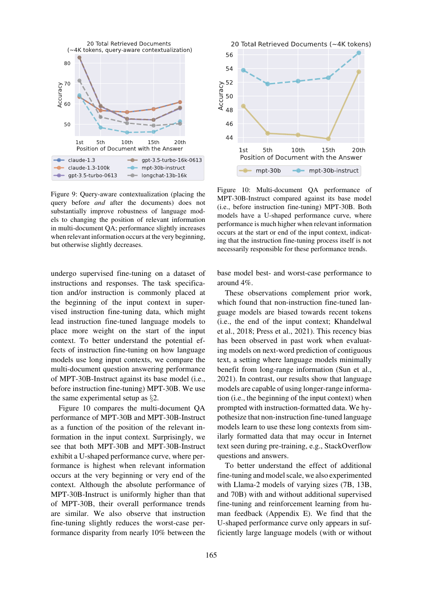

# 证据位置与问题位置，为什么不是同一件事？

我用《Lost in the Middle》的一个具体阅读问题测试结构化证据流程：**把相关文档放在开头，是否等价于把问题在材料前后各放一次？** 论文的答案是否定的。前者改变文档中相关信息的位置；后者改变query能否参与文档的上下文化。两者既不是同一个变量，也不能把一个任务上的提升搬到另一任务。

本分享提供两次新的真实玻尔调用、实际失败、可运行行号校验，以及PDF原文位置。它是一个阅读与核查教程，没有复现论文中的GPU实验，也未证明改进提示词普遍优于基线。实验问题与验收标准在调用前冻结；我是材料设计者，熟悉论文，核查由Codex辅助完成，非盲、非独立评审。

## 先用原文回答问题

| 阅读问题 | 原文所支持的结论 | 本地定位 |
|---|---|---|
| 移动了什么？ | 文档重排改变相关信息位置；query-aware在数据前后放query | numbered.txt中LIM-P2:18–26，LIM-P8:33–49 |
| 为什么query位置可能有影响？ | decoder-only每个token只能关注先前token，末尾query无法被此前文档token用于上下文化 | LIM-P8:33–41 |
| key-value结果如何？ | 75、140、300对设置下各模型接近完美；16K GPT-3.5的300对示例为完美 | LIM-P8:50–57 |
| 多文档QA是否同样提升？ | 位置鲁棒性未得到实质改善，相关信息在开头略好、其它位置略差 | LIM-P8:58–67，LIM-P9:1–7/Figure9 |

这些行号是本项目按Python `splitlines()` 对所供页面文本编号的定位，不是PDF原版行号。页码为物理PDF页：2、8、9，印刷页分别158、164、165。只给模型读取这三页抽取文本；不声称全文上下文均进入提示。



图来自论文物理第9页（印刷165），左侧Figure9的横轴为含答案文档的位置，纵轴Accuracy，20个检索文档、约4K tokens，query-aware条件下中间位置仍较差。右侧Figure10是instruction tuning对比，不能混作同一干预。这里只作定性阅读，未从图片估算新数值；核心结论可由图注文字核查。完整页图保留出处。

## 一套可以照做的阅读流程

1. 写下具体问题，先列干预对象、改变变量、任务和观察指标，避免只问“怎样解决lost in the middle”。本次问题见[task.txt](task.txt)。
2. 给原文逐行编号，并在提示中保留来源ID和物理页；要求回答只输出source_id/start_line/end_line，由脚本提取对应原文。这样无需模型重新抄写跨行英文，但仍可能选错证据，必须另判语义。
3. 在[workflow.txt](workflow.txt)中约束先拆干预，再分别读key-value和QA，最后给有条件建议。完整输入和原始响应均保留，见文件索引。
4. 严格解析JSON并检查D1–D4覆盖、整数行号和范围。解析失败即停止，不能把“看得懂”当成可被程序读取；通过也只证明定位合法。
5. 对照原文判断每段证据是否真正支撑主张，尤其检查对未测模型、产品收益、架构替换的外推。解释、定位和建议可用性分别核验。

这里行号回填只复用给定文本，不访问文件路径或执行回答里的命令。输入文本带三位数字只是显示格式，JSON中的数值仍必须是十进制合法整数，例如18，不能018。这一差别正是本次真实失败。

## 真实结果：解释方向对，仍不能自动使用

两次调用均用Bohrium CLI2.8.1原生exe，请求gpt-5-mini，实际返回chenkun/gpt-5-mini；同论文页、任务、无历史/无工具、180秒预算，第二次多加载workflow。服务精确snapshot、temperature、seed不公开。每次有不同非语义nonce，官方dry-run已逐字符验证实际message。两次只能说明本案例观察，不能给出稳定性或统计显著性结论。

|条件|秒|输入/输出token|机械检查|
|---|---:|---:|---|
|baseline|20.098|3034/2701|ranges_valid，15条范围|
|workflow|25.841|3145/3311|invalid_json，未进入范围验证|


基线能区分两个操作，也指出key-value和QA效果不同，但D4把query-aware说成“高效且立竿见影”，并提出改成encoder-decoder等路径，超出三页材料可直接保证的范围。后面的限制段虽有收敛，仍不能原样当部署建议。

加workflow后的原答同样区分操作和任务，但行号出现`018`、`032`、`001`，严格JSON解析在首个前导零位置失败。原文件[workflow-output.json](workflow-output.json)保留原样，不自动去零、不重生成；[workflow-validation.json](workflow-validation.json)记录真实解析错误。因此本次没有可直接由程序消费的workflow结果，也不能声称定位收益已验证。D2还把“只改变变量、其他条件受控”说得过满，三页材料没有完整隔离全部潜在协变量的证据。

基线的16个行范围均存在，但存在不充分证据：D2援引P8:45–49主要说明query-aware设计，并不覆盖其前一句关于decoder-only因果限制，需连同33–41核查；D4的P8:26–31不是通用架构替换有效性的证据。**行号合法与科学解释有据，是两道不同的门。** 完整逐项核查见[audit.md](audit.md)。

本次发现带来两个可检验改进：提示改用字符串行号或无补零编号，并给合法JSON示例；生成后严格校验再进行受限修复。它们尚未在本版重新运行验证，不能当作本版成功结果。已有输出和全部失败均保留，不以漂亮重写替换。

## 本地复查与独立重做

仅复查已保存结果，不需要账号或联网，Python3标准库即可：

```sh
python validate.py sources.json baseline-output.json
python validate.py sources.json workflow-output.json
```

第一条预期ranges_valid且15条提取；第二条预期invalid_json并退出1。这是故意保留的真实失败，不能改为“所有检查通过”。需要人工阅读输出与原文的支持关系。

要重新调用，先从玻尔官方渠道安装Bohrium CLI并手动登录，确认光子额度。使用原生可执行程序，Windows的.cmd曾截断多行message。修改[replay.py](replay.py)时不要加入凭据，直接：

```sh
python replay.py --bohr /absolute/path/to/bohr --condition baseline --out new-baseline
python replay.py --bohr /absolute/path/to/bohr --condition workflow --out new-workflow
```

新输出不保证逐字一致，应按[criteria.md](criteria.md)核查。同一out目录不得重复使用。费用未得到逐次货币扣费信息，填null；输入/输出token和耗时见metadata，不拿私有余额推算成本。首次准备抽取使用pypdf，复查和重跑仅标准库。若本机代理导致官方Vouch连接断开，只对子进程移除HTTP_PROXY/HTTPS_PROXY/ALL_PROXY及小写变量；不要全局改系统配置。本次调用就是这一网络配置，replay显式采用相同方式。

## 文件与来源

- `sources.json`：三页pypdf原样抽取；`numbered.txt`：实际展示给模型的编号版本，换行规则见上文。
- `task.txt`/`workflow.txt`/`criteria.md`/`protocol.md`：问题、方法、事前标准；`protocol-lock.json`是实验工作目录冻结哈希，路径对应制作来源，不是扁平发布目录，复核映射见audit.md。
- `baseline-*`/`workflow-*`：完整request、preflight、response、原output、metadata、stderr、离线validation。response内只脱敏私人余额，回答、usage、模型、completion ID保留。
- `validate.py`/`replay.py`：检查和重做入口；`audit.md`逐项核验；`SOURCES.md`署名许可。

论文：Nelson F. Liu, Kevin Lin, John Hewitt, Ashwin Paranjape, Michele Bevilacqua, Fabio Petroni, Percy Liang. *Lost in the Middle: How Language Models Use Long Contexts*. TACL 12 (2024),157–173. DOI [10.1162/tacl_a_00638](https://doi.org/10.1162/tacl_a_00638)，[ACL版本](https://aclanthology.org/2024.tacl-1.9/)，CC-BY4.0。材料取自最终PDF，本包仅共享必要原文片段和第9页图，未把整篇全文重复放入评分包。原文研究归论文作者；我的贡献是聚焦干预区别、构建编号材料与检查器、两次真实玻尔实践、核查与失败教程。原创代码/文字MIT，第三方论文仍按CC-BY4.0。
